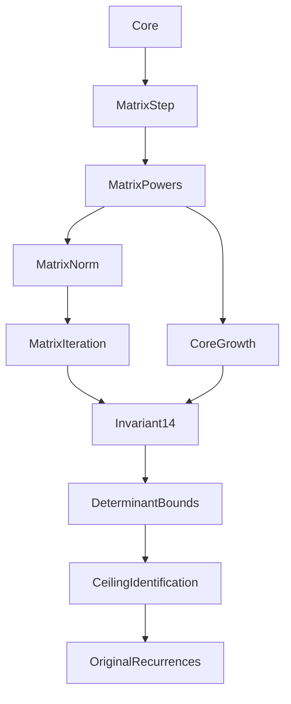

# Proof dependency map

An import arrow in the diagram points from a prerequisite to its user. These
are file-level imports; the narrative summary explains the theorem-level chain.

| Mathematical module | Direct imports |
|---|---|
| `Pisot.Core` | `Mathlib` |
| `Pisot.MatrixStep` | `Pisot.Core` |
| `Pisot.MatrixPowers` | `Pisot.MatrixStep` |
| `Pisot.MatrixNorm` | `Pisot.MatrixPowers` |
| `Pisot.MatrixIteration` | `Pisot.MatrixNorm` |
| `Pisot.CoreGrowth` | `Pisot.MatrixPowers` |
| `Pisot.Invariant14` | `Pisot.MatrixIteration`, `Pisot.CoreGrowth` |
| `Pisot.DeterminantBounds` | `Pisot.Invariant14` |
| `Pisot.CeilingIdentification` | `Pisot.DeterminantBounds` |
| `Pisot.OriginalRecurrences` | `Pisot.CeilingIdentification` |

The single external mathematical import is `Mathlib` in `Core.lean`; its
transitive imports resolve through the exact nine locked dependencies.

| Original milestone audit | Direct import |
|---|---|
| `Pisot.M1Audit` | `Pisot.Core` |
| `Pisot.M2AAudit` | `Pisot.MatrixStep` |
| `Pisot.M2B1Audit` | `Pisot.MatrixPowers` |
| `Pisot.M2B2A1Audit` | `Pisot.MatrixNorm` |
| `Pisot.M2B2A2Audit` | `Pisot.MatrixNorm` |
| `Pisot.M2B2BAudit` | `Pisot.MatrixIteration` |
| `Pisot.M3A1Audit` | `Pisot.CoreGrowth` |
| `Pisot.M3A2Audit` | `Pisot.CoreGrowth` |
| `Pisot.M3BAudit` | `Pisot.Invariant14` |
| `Pisot.M4Audit` | `Pisot.DeterminantBounds` |
| `Pisot.M5Audit` | `Pisot.OriginalRecurrences` |

`Pisot.lean` imports every one of these 21 files, giving 22 original compiled
modules including itself. `audit/M6FinalAudit.lean` imports `Pisot` and is run
explicitly after the build. It is an extracted historical inspection input,
not an altered proof module. Complete direct imports, including the root, are
recorded in [import-graph.json](../provenance/import-graph.json).

The release package checker verifies the original import graph is acyclic,
contains no missing local module, and has every original module reachable
from the default root. No private manuscript, historical Python experiment,
or raw log is imported by the mathematical project.
